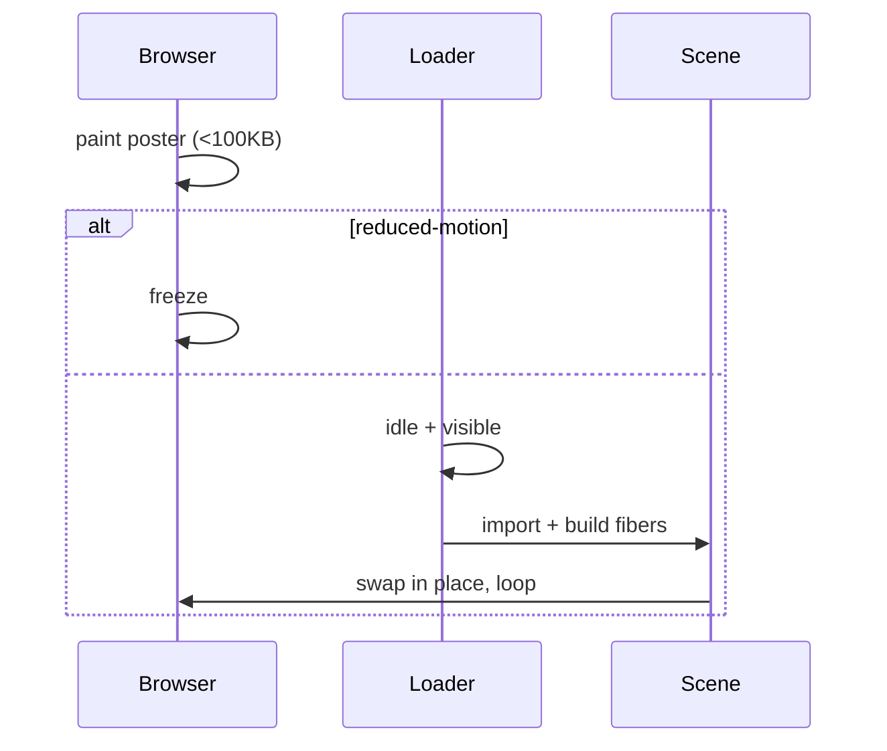
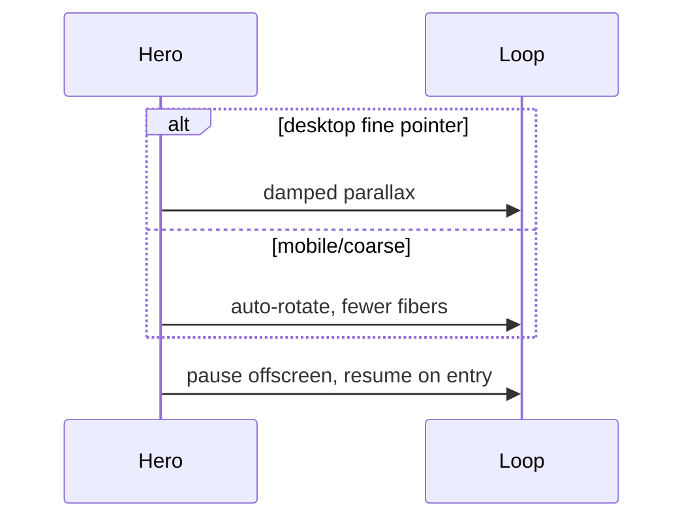

# Design: Lamnda Marketing Site v1

## Technical Approach

Astro static export, zero-JS default. Single `HopfHero` island (`client:idle`) owns WebGL; rest is static HTML + `tokens.css`. Collections + Zod schemas let TBD texts swap via `.md` only. Covers `site-structure / hero-hopf / theme-i18n / services-content`.

## Architecture Decisions

### D1: Astro island vs Vite-vanilla vs Next.js+R3F

| Option | Tradeoff | Verdict |
|---|---|---|
| Astro + vanilla Three island | Zero-JS, collections, any static host; new model | **Chosen** |
| Vite + vanilla TS | Smallest bundle; hand-rolled routing/content | Rejected: growth debt |
| Next.js + R3F | App ecosystem; hurts LCP, export discipline | Rejected: overkill |

Rationale: LCP + content-swap dominate; islands give SEO + one canvas.

### D2: Fiber lines vs bloom shader

| Option | Tradeoff | Verdict |
|---|---|---|
| Precomputed `LineSegments` + `Points` | <30 draws, deterministic; less glow | **Chosen** |
| GLSL + UnrealBloomPass | Closest to ref; mobile risk, maintenance | Rejected: breaks budget |
| Poster-only | Safest LCP; no interaction | Complement only |

Rationale: budget load-bearing; glow via additive blending, no postpass.

### D3: CSS vars vs Tailwind theme

| Option | Tradeoff | Verdict |
|---|---|---|
| `tokens.css` on `<html data-theme>` | ~2KB, anti-FOUC, AA contract | **Chosen** |
| Tailwind dark: classes | Faster authoring; weight + duplication | Rejected |

Rationale: tokens are the contract; utilities can layer later.

### D4: `es` default + EN exception vs full EN routes

| Option | Tradeoff | Verdict |
|---|---|---|
| `es` + pinned EN headline + comment | Keeps KEEP phrase, defers cost | **Chosen** |
| Full `/en` in v1 | Complete; blocked on missing texts | Rejected: out of scope |

Rationale: unblocks v1; comment + spec guard stop mistranslation.

## Data Flow

```text
.md --validate--> build --> static HTML + poster + island JS --> Pages/Vercel/Netlify
Browser paints poster --> idle/visible --> import three --> canvas swaps in place (no CLS)
```

Hero load:



Hero interaction:



Pipeline: WebP poster <100KB (`fetchpriority=high`, fixed size); three dynamically imported, hero <200KB gzip; DPR `min(dpr, mobile?1.5:2)`; ~48 (desktop)/~24 (mobile) x128-seg fibers merged into 1 lines + 1 points object; `HOPF_ENABLED=false` → poster-only.

## File Changes

| File | Action | Description |
|---|---|---|
| `astro.config.mjs`, `package.json`, `tsconfig.json` | Create | Static output, three dep |
| `src/layouts/Base.astro` | Create | SEO meta, anti-FOUC script |
| `src/pages/index.astro` | Create | hero→pillars→services→vision→contact |
| `src/components/HopfHero.astro`, `hopf-scene.ts` | Create | `client:idle` island + fiber builder |
| `src/components/*.astro` (Header, Sections, Footer) | Create | Anchors, CSS/SVG mock dashboard |
| `src/content/config.ts`, `content/**/*.md` | Create | Schemas + swappable texts |
| `src/styles/tokens.css` | Create | Locked tokens below |
| `public/hero-poster.webp` | Create | LCP poster |
| `.gitignore`, `README.md` | Create | Ignores, run notes |

## Interfaces / Contracts

| Token | Dark on `#0A1628` | Light on `#FFFFFF` |
|---|---|---|
| `--bg/--surface/--text/--muted` | `#0A1628/#12233D/#EAF1FB/#9DB1CC` | `#FFFFFF/#F3F6FB/#101A2B/#4A5B74` |
| `--primary` (brand `#2E8CFF`, graphics only) | `#2E8CFF` | `#2E8CFF` |
| `--primary-text` (AA ≥4.5:1) | `#7AB3FF` | `#0A54C2` |

```ts
export const service = z.object({
  title: z.string(), pillar: z.enum(["data","security","automation"]),
  priority: z.number().int().min(1).max(7), summary: z.string(),
  bullets: z.array(z.string()).max(5), lang: z.enum(["es","en"]),
  card: z.enum(["full","summary"]), draftLabel: z.string().optional(),
});
```

Island props: `{ posterSrc, fiberCount?, autoRotate? }`; internally honors `max-width:768px` and `prefers-reduced-motion`.

## Testing Strategy

| Layer | What to Test | Approach |
|---|---|---|
| Unit (Vitest) | Fiber counts, AA pairs, EN constant | Pure asserts |
| Integration | TBD build green, poster/gzip budgets | Build checks in CI |
| E2E (Playwright) | Anchors, CTA scroll/no-JS, theme persist, motion freeze, mobile | Desktop + 390px + reduced-motion |

## Threat Matrix

N/A — static anchors only; no shell/subprocess, VCS automation, executable classification, or process integration.

## Migration / Rollout

No migration (greenfield). Rollback via prior artifact or `git revert`; hero escape hatch `HOPF_ENABLED=false`.

## Open Questions

- [ ] Deploy target + remote (default Cloudflare Pages)?
- [ ] TBD texts non-blocking confirmed?
- [ ] Lock `--primary-text` hexes vs brand alternate (verify AA in `sdd-verify`)?
